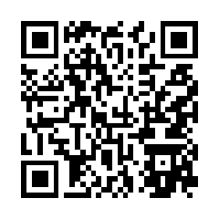

# MsgDrive

[正體中文](#正體中文) | [English](#english)

## 正體中文

此 repo 只放 MsgDrive 建置後的網頁檔;原始碼不公開。

### 加到手機主畫面

用手機相機掃描 QR 碼,開啟安裝頁後照著做;已經在手機上看這一頁的話,直接開[安裝頁](https://sanjalang.github.io/msgdrive-app/#/install)。瀏覽器規定要由使用者自己確認,所以掃描後還要按幾下:Android 按「安裝」,iPhone 照頁面上的三個步驟。

## English

This repo contains only the built web files of MsgDrive; the source code is not public.

### Add it to your phone's home screen

Scan the QR code with your phone's camera, then follow the install page; if you are already reading this on your phone, open the [install page](https://sanjalang.github.io/msgdrive-app/#/install) directly. Browsers require you to confirm this yourself, so a few taps remain after scanning: tap "Install" on Android, or follow the three steps on the page on an iPhone.

